# Example: Douma, Syria

An AOI polygon covering the city of **Douma** (دوما), Rif Dimashq Governorate, Syria, about 10 km north-east of Damascus.

| File | Description |
|---|---|
| `douma.geojson` | Polygon covering Douma city (EPSG:4326) |
| `douma_20260913_rgb.png` | Sample output: true colour, 13 September 2026 |
| `douma_20260913_falsecolor.png` | Sample output: false colour (NIR, red, green), same scene |
| `bands/` | Previews of each of the 12 spectral bands plus the `swir` and `agriculture` presets, same scene (see [All bands](#all-bands)) |

| True colour (`--bands rgb`) | False colour (`--bands falsecolor`) |
|---|---|
| 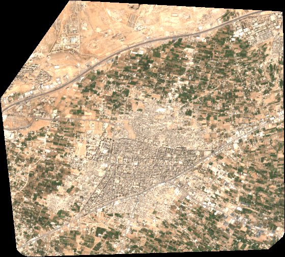 | 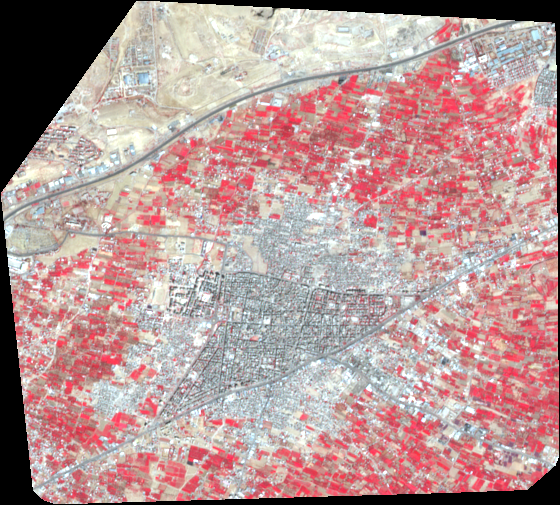 |

In false colour, the irrigated farmland of the Eastern Ghouta shows bright red around the grey city core.

## Run it

From the project root:

```bash
# True colour (default)
python download_s2.py examples/douma/douma.geojson --start 2026-06-01 --end 2026-09-30

# False colour
python download_s2.py examples/douma/douma.geojson --start 2026-06-01 --end 2026-09-30 --bands falsecolor
```

- Douma falls in Sentinel-2 tile **37SBT** (UTM zone 37N, EPSG:32637).
- At 10 m resolution the output is about **560 × 505 px**.
- Summer months (June–October) are almost always cloud-free here. Winter (December–February) is often cloudy, so use `--max-cloud 30` or a wider date range.

## All bands

Every band and preset from the same scene (Sentinel-2A, 13 September 2026), as the script produces them.

### Colour presets

| `rgb` — B04, B03, B02 | `falsecolor` — B08, B04, B03 |
|---|---|
|  |  |
| True colour, as the eye sees it. | Vegetation shows bright red; the city core and roads show grey. |
| **`swir` — B12, B08, B04** | **`agriculture` — B11, B08, B02** |
| 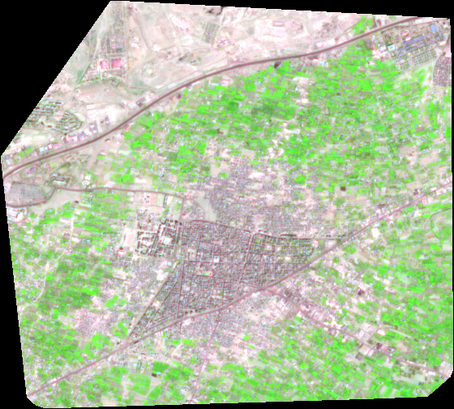 | 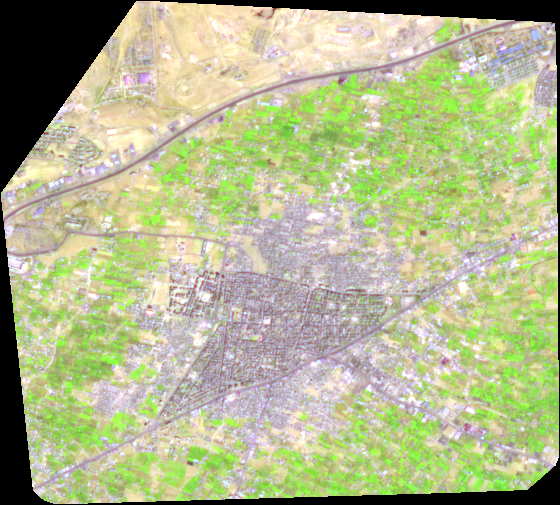 |
| Vegetation shows green, while built-up areas and bare soil show pink and purple. | Healthy crops show bright green; dry and bare ground shows brown and pink. |

### Single bands

Each band is shown in greyscale and stretched to its own range, so brightness is comparable within a band but not between bands. Bands with a native resolution of 20 m or 60 m are resampled to 10 m, which does not add detail. The 60 m bands (B01, B09) are visibly blurry.

| B01 `coastal` · 443 nm · 60 m | B02 `blue` · 490 nm · 10 m | B03 `green` · 560 nm · 10 m |
|---|---|---|
|  | 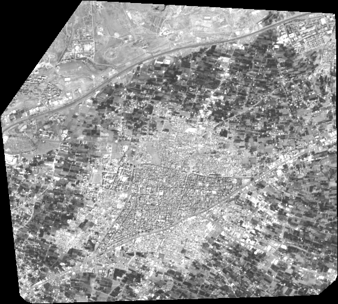 | 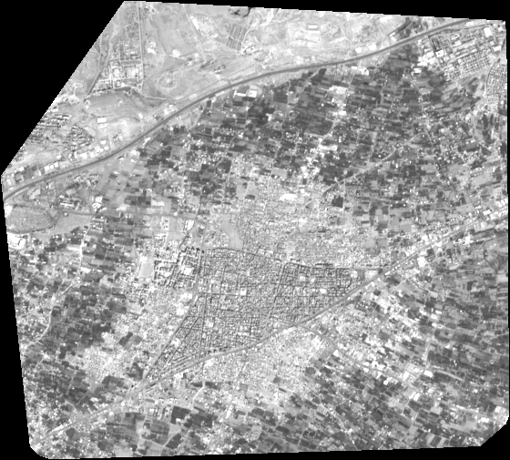 |
| Aerosols and haze; very coarse. | Haze and water; low contrast. | Vegetation is slightly brighter here than in blue or red. |
| **B04 `red` · 665 nm · 10 m** | **B05 `rededge1` · 704 nm · 20 m** | **B06 `rededge2` · 740 nm · 20 m** |
| 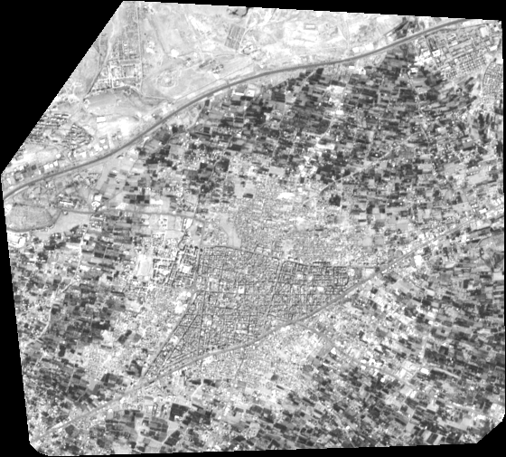 |  | 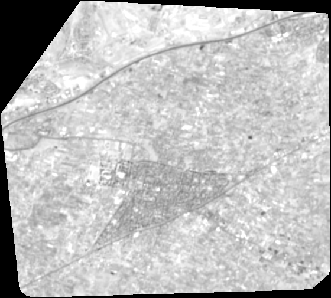 |
| Chlorophyll absorbs red, so fields look dark. | Start of the red edge, where vegetation reflectance climbs. | Vegetation is now brighter than its surroundings. |
| **B07 `rededge3` · 783 nm · 20 m** | **B08 `nir` · 842 nm · 10 m** | **B8A `nir08` · 865 nm · 20 m** |
| 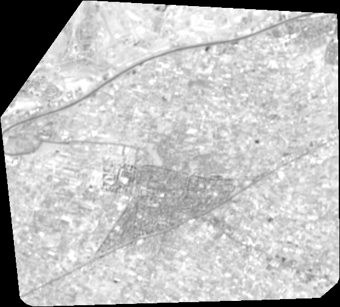 | 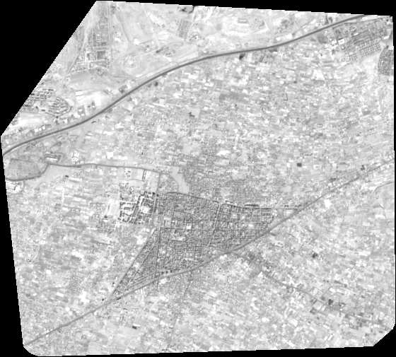 |  |
| Close to the NIR plateau. | Fields are bright; the sharpest NIR band. | Narrow NIR; like B08 but softer. |
| **B09 `nir09` · 945 nm · 60 m** | **B11 `swir16` · 1610 nm · 20 m** | **B12 `swir22` · 2190 nm · 20 m** |
|  | 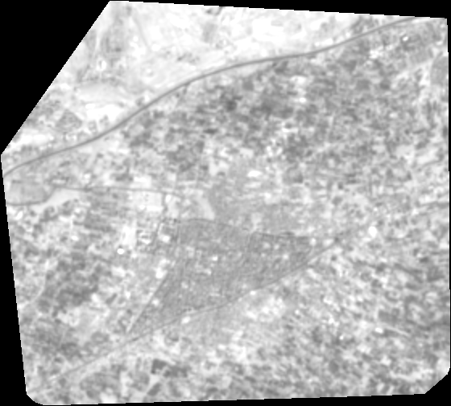 | 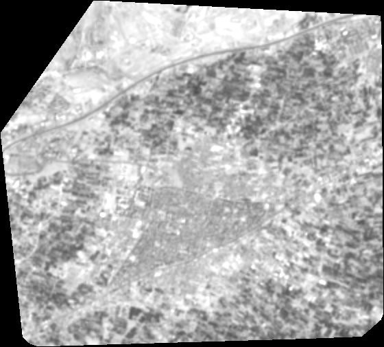 |
| Water vapour absorption; very coarse. | Moisture: irrigated fields are dark, dry desert to the north is bright, and the city is mid-grey. | Like B11, with stronger contrast between built-up and vegetated areas. |

To reproduce these images:

```bash
# A single band, as greyscale
python download_s2.py examples/douma/douma.geojson --start 2026-09-01 --end 2026-09-30 --bands swir16

# A preset
python download_s2.py examples/douma/douma.geojson --start 2026-09-01 --end 2026-09-30 --bands swir

# All 12 bands in one GeoTIFF (no preview images)
python download_s2.py examples/douma/douma.geojson --start 2026-09-01 --end 2026-09-30 --bands all
```

## How the polygon was made

OpenStreetMap has no administrative boundary for **Douma city** itself. Douma is mapped as a point, and the smallest boundary that contains it is the much larger *Duma Subdistrict* (ناحية مركز دوما). The polygon was therefore built from OSM land-use data:

1. Download all `landuse=residential|commercial|retail|industrial` polygons in the Douma area using the Overpass API (2026-10-12).
2. Keep the 85 polygons whose centres lie within Douma's extent (36.378–36.432 °E, 33.556–33.598 °N). This leaves out neighbouring Harasta (west), Misraba and Mudayra (south).
3. Take the **convex hull** (the smallest outline that encloses all of them).

The result is a single 15-vertex polygon of **about 25 km²**, spanning roughly **36.372–36.433 °E, 33.554–33.600 °N**. It covers the dense city core, the surrounding built-up area and the eastern industrial zone. Because it is a convex hull, it also includes some of the farmland around the edges. This makes it suitable for clipping imagery, but it is **not an official municipal boundary**.

The same method works for any town that OSM maps only as a point.

## Licence

Polygon data © OpenStreetMap contributors, licensed under the [ODbL 1.0](https://opendatacommons.org/licenses/odbl/).
